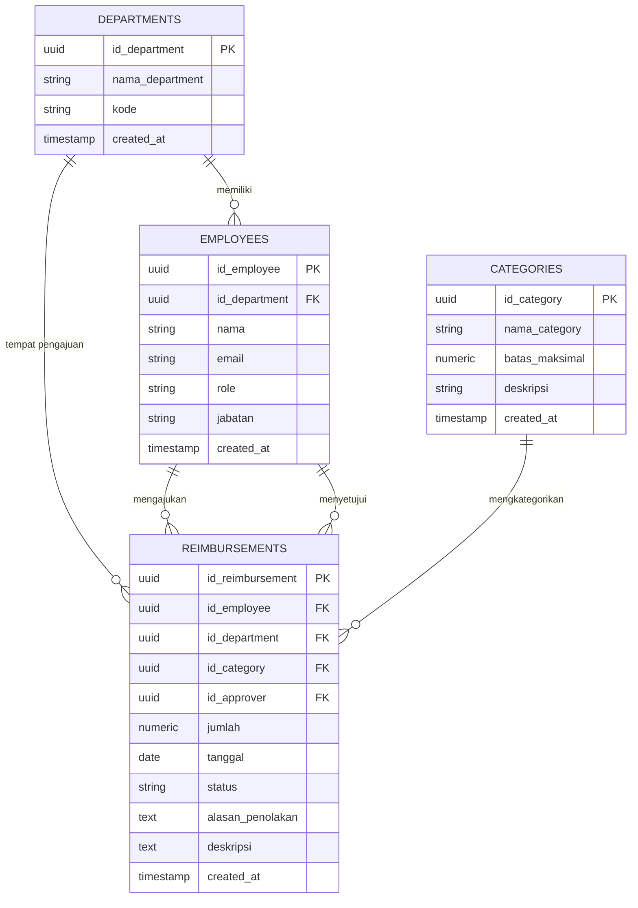
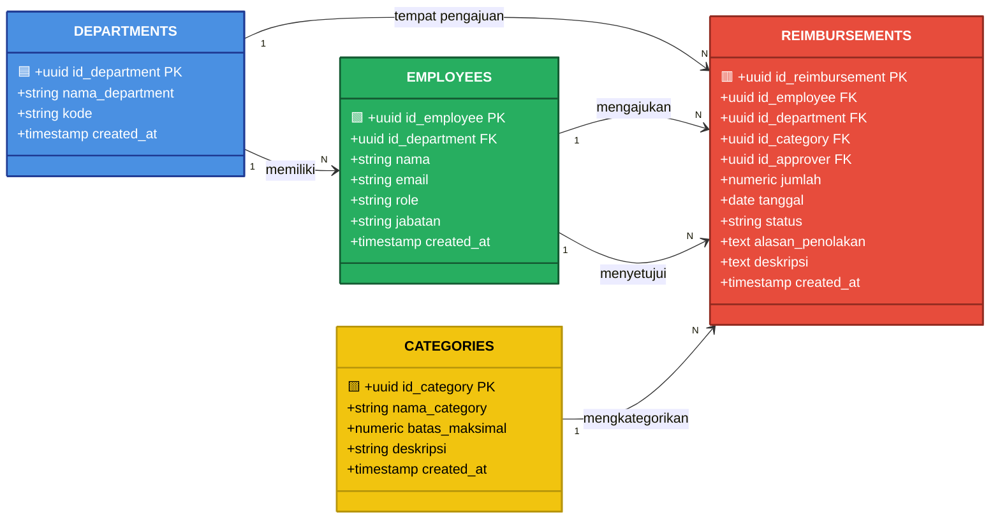

# 💼 KlaimKu

### Sistem Reimbursement Perusahaan Berbasis Web

<p align="center">
  <b>SULISTIANI</b><br>
  NIM: 12030124120066<br>
  Mata Kuliah/Kelas: Pengkodean dan Pemrograman / D<br>
  Dosen Pengampu: Dr. Totok Dewayanto, S.E., M.Si., Akt., CA
</p>

<p align="center">
  <b>PROGRAM STUDI S1 AKUNTANSI</b><br>
  <b>FAKULTAS EKONOMIKA DAN BISNIS</b><br>
  <b>UNIVERSITAS DIPONEGORO</b>
</p>

<p align="center">
  🔗 <a href="https://sulistianisketch.github.io/reimbursement-app/"><b>▶ KLIK DI SINI UNTUK MEMBUKA SISTEM ◀</b></a>
</p>

---

## 📖 Deskripsi

**KlaimKu** adalah aplikasi web sistem reimbursement perusahaan dengan dashboard, empat data master, frontend HTML/CSS/JavaScript, backend Node.js bawaan, dan database **Supabase Postgres**.

Tidak membutuhkan `package.json`, framework, CDN, atau berkas environment.

### 🧩 Empat Entitas Utama

| Entitas | Fungsi |
|---|---|
| 🏢 **Departments** | Data master departemen/divisi perusahaan |
| 👥 **Employees** | Data karyawan beserta perannya |
| 🏷️ **Categories** | Kategori pengeluaran reimbursement |
| 🧾 **Reimbursements** | Pengajuan klaim reimbursement karyawan |

---

## 🗂️ Entity Relationship Diagram (ERD)



### 🎨 Diagram ERD (Versi Berwarna)

> Diagram di bawah menggunakan **Mermaid** dengan **classDiagram** yang mendukung warna per entitas agar lebih mudah dibaca.



### 🔗 Relasi Antar Entitas

| Relasi | Kardinalitas | Keterangan |
|---|---|---|
| Departments → Employees | 1 : N | Satu departemen memiliki banyak karyawan |
| Departments → Reimbursements | 1 : N | Satu departemen menaungi banyak pengajuan |
| Employees → Reimbursements | 1 : N | Satu karyawan dapat mengajukan banyak reimbursement |
| Categories → Reimbursements | 1 : N | Satu kategori dipakai oleh banyak pengajuan |
| Employees → Reimbursements (approver) | 1 : N | Satu approver dapat menyetujui banyak pengajuan |

---

## 🧱 Struktur Tabel

### 🏢 1. `departments`
| Kolom | Tipe | Keterangan |
|---|---|---|
| 🔑 id_department | uuid (PK) | Primary key |
| nama_department | text | Nama departemen/divisi |
| kode | text | Kode singkat departemen |
| created_at | timestamptz | Waktu data dibuat |

### 👥 2. `employees`
| Kolom | Tipe | Keterangan |
|---|---|---|
| 🔑 id_employee | uuid (PK) | Primary key |
| 🔗 id_department | uuid (FK) | Referensi ke `departments` |
| nama | text | Nama karyawan |
| email | text | Email login karyawan |
| role | text | `karyawan` / `finance` / `admin` |
| jabatan | text | Jabatan karyawan |
| created_at | timestamptz | Waktu data dibuat |

### 🏷️ 3. `categories`
| Kolom | Tipe | Keterangan |
|---|---|---|
| 🔑 id_category | uuid (PK) | Primary key |
| nama_category | text | Nama kategori reimbursement |
| batas_maksimal | numeric | Batas maksimal nominal klaim |
| deskripsi | text | Penjelasan kategori |
| created_at | timestamptz | Waktu data dibuat |

### 🧾 4. `reimbursements`
| Kolom | Tipe | Keterangan |
|---|---|---|
| 🔑 id_reimbursement | uuid (PK) | Primary key |
| 🔗 id_employee | uuid (FK) | Referensi ke `employees` (pengaju) |
| 🔗 id_department | uuid (FK) | Referensi ke `departments` |
| 🔗 id_category | uuid (FK) | Referensi ke `categories` |
| 🔗 id_approver | uuid (FK) | Referensi ke `employees` (penyetuju) |
| jumlah | numeric | Nominal yang diklaim |
| tanggal | date | Tanggal pengajuan |
| status | text | `pending` / `approved` / `rejected` |
| alasan_penolakan | text | Alasan jika ditolak |
| deskripsi | text | Keterangan pengajuan |
| created_at | timestamptz | Waktu data dibuat |

> 📄 Dokumentasi lengkap (skema, kamus data, aturan RLS, alur reimbursement): [`docs/skema-sistem-reimbursement.md`](docs/skema-sistem-reimbursement.md)

---

## 📁 Struktur Proyek

```text
frontend/
  index.html
  styles.css
  app.js
backend/
  app.js
database/
  schema.sql
  bootstrap-admin.sql
```

Empat entitas database: `departments`, `employees`, `categories`, dan `reimbursements`.

---

## 🚀 Membuka Aplikasi

- Buka `frontend/index.html` langsung di browser untuk mencoba mode demo. Data demo disimpan di local storage browser.
- Untuk menjalankan server opsional, gunakan **Node.js 18+**: `node backend/app.js`, lalu buka `http://localhost:4173`.
- Endpoint pemeriksaan server: `http://localhost:4173/api/health`.

---

## 🔐 Menyiapkan Supabase

1. Buat project Supabase.
2. Buka SQL Editor, lalu jalankan seluruh isi `database/schema.sql`.
3. Buka aplikasi, klik **Supabase terhubung** di kiri bawah, lalu isi Project URL dan publishable key. `anon` key lama juga didukung. **Jangan** masukkan secret key atau `service_role` key ke frontend.
4. Pada Supabase Authentication, sesuaikan URL configuration untuk alamat tempat aplikasi akan dibuka. Pastikan aturan email confirmation sesuai kebutuhan perusahaan.
5. Buat akun dan login ke KlaimKu menggunakan email yang akan dijadikan admin.
6. Buka `database/bootstrap-admin.sql`, ganti `GANTI_DENGAN_EMAIL_LOGIN_ANDA` dengan email login Anda, lalu jalankan seluruh skrip di SQL Editor. Skrip ini menambahkan departemen dan kategori awal serta menautkan akun menjadi admin.
7. Muat ulang KlaimKu. Admin dapat mengelola data master dan menyetujui pengajuan. Hak akses database tetap diperiksa dengan **Row Level Security (RLS)**; publishable key bukan pengganti autentikasi.

> 💡 Jika Finance/Admin tidak dapat membuat pengajuan untuk karyawan lain, jalankan `database/fix-reimbursement-insert-policy.sql` di SQL Editor lalu muat ulang aplikasi.

---

## ✨ Fitur

- 📊 **Dashboard** ringkasan, tren bulanan, kategori teratas, dan pengajuan terbaru.
- 🗂️ **Master data** karyawan, departemen, dan kategori dengan tambah, ubah, hapus, dan pencarian.
- 🧾 **Pengajuan reimbursement**, validasi batas kategori, detail, persetujuan, dan penolakan dengan alasan.
- 🔑 **Peran pengguna**: karyawan, finance, dan admin, beserta kebijakan RLS pada empat tabel.
- 📱 **Layout responsif**, navigasi mobile, ilustrasi uang SVG, dan animasi yang menghormati pengaturan reduced motion.

---

<p align="center">
  <b>© 2025 SULISTIANI — Universitas Diponegoro</b><br>
  <i>Sistem Reimbursement KlaimKu | Pengkodean dan Pemrograman / D</i>
</p>
